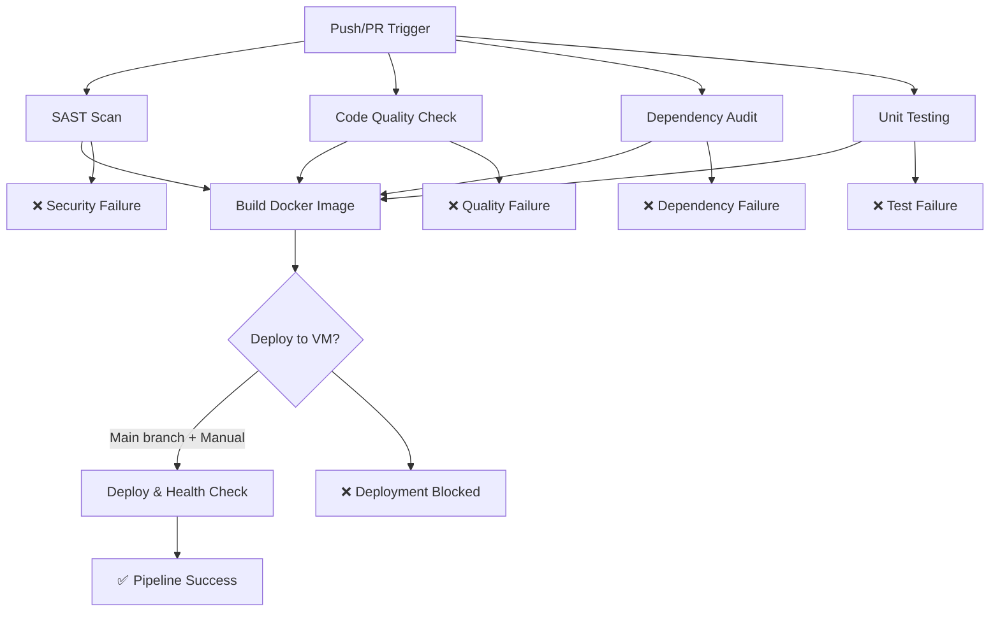

# Dokumentasi Pipeline ATS-CI-CD

## Overview

Pipeline CI/CD yang telah diperbaiki dengan job-job terpisah (1-1 flow) sesuai dengan contoh `IMP-devsecops.yml`.

## Perubahan yang Dilakukan

### 1. Memisahkan Job-Job (1-1 Flow)
- **Sebelum**: 2 job besar (ci-job dan cd-job) dengan banyak steps
- **Sesudah**: 6 job terpisah yang independen:
  1. `sast-scan` - Security scanning dengan Semgrep
  2. `code-quality` - Code quality dengan Pylint
  3. `dependency-audit` - Dependency security audit
  4. `unit-test` - Unit testing dengan coverage
  5. `docker-build` - Build Docker image
  6. `deploy-vm` - Deploy ke VM server

### 2. Workflows Baru yang Dibuat

#### a. `ci-quality.yml`
- Pipeline khusus untuk code quality checks
- Job-jobs: sast-scan, pylint-check, dependency-audit, unit-test
- Berjalan secara paralel
- Cocok untuk PR validation

#### b. `deploy-vm.yml`
- Pipeline deployment ke VM
- Menggunakan SSH dengan credentials: kenn@192.168.238.132 / matcha123
- Health check dan monitoring container

#### c. `full-pipeline-separated.yml`
- Pipeline lengkap dengan semua job terpisah
- Mengikuti pola 1-1 flow
- Conditional deployment hanya pada push ke main/master

#### d. `study-case-success.yml`
- Simulasi pipeline sukses untuk pembelajaran
- Menunjukkan semua checks pass
- Output summary yang informatif

#### e. `study-case-failure.yml`
- Simulasi berbagai skenario kegagalan:
  - Code quality failure (Pylint score rendah)
  - Security scan failure (vulnerabilities ditemukan)
  - Dependency audit failure (vulnerable packages)
  - Test failure (unit tests gagal)
  - Deployment failure (VM connection failed)

## Diagram Flow Pipeline



## Konfigurasi VM Server

### SSH Access
```bash
Host: 192.168.238.132
User: kenn
Password: matcha123
```

### Prasyarat di VM:
1. Docker terinstal dan berjalan
2. Port 5000 terbuka
3. GitHub Actions self-hosted runner terinstal

### Testing Connection:
```bash
# Test SSH
ssh kenn@192.168.238.132

# Test Docker
docker ps

# Test aplikasi (setelah deploy)
curl http://localhost:5000/health
```

## Study Cases

### Success Case
**Trigger**: Manual melalui GitHub Actions
**Output**: Semua checks pass, aplikasi deployed dan healthy

### Failure Cases
1. **Code Quality Gate**: Pylint score < 9.0
2. **Security Gate**: Critical vulnerabilities ditemukan
3. **Dependency Gate**: Vulnerable packages
4. **Test Gate**: Unit tests gagal
5. **Deployment Gate**: VM connection failed

Setiap failure menunjukkan preventive action yang harus diambil.

## Monitoring dan Alerting

Pipeline menyediakan:
1. Artifact upload untuk test results dan coverage
2. Health check otomatis setelah deployment
3. Resource monitoring container
4. Cleanup dangling images

## Troubleshooting Guide

### Issue: Pipeline stuck di "Setup SSH Connection"
**Solution**: 
- Periksa SSH key di GitHub Secrets
- Test koneksi manual ke VM
- Pastikan VM sedang berjalan

### Issue: Docker build failed
**Solution**:
- Periksa Dockerfile syntax
- Pastikan requirements.txt valid
- Check disk space di runner

### Issue: Health check failed
**Solution**:
- Check container logs: `docker logs ats-web-flask`
- Verify port mapping: `docker ps`
- Test endpoint manually

### Issue: Unit tests failing
**Solution**:
- Run tests locally: `pytest tests/`
- Check test dependencies
- Update test assertions jika diperlukan

## Best Practices Implemented

1. **Security First**: SAST scan sebelum build
2. **Quality Gates**: Pylint dengan threshold 9.0
3. **Dependency Hygiene**: pip-audit untuk security audit
4. **Test Coverage**: pytest dengan coverage reporting
5. **Container Security**: Non-root user di Dockerfile
6. **Health Monitoring**: Health check endpoints
7. **Resource Cleanup**: Docker image pruning
8. **Artifact Management**: Upload test results dan coverage

## Repository Structure

```
.github/workflows/
├── ci-quality.yml          # CI checks terpisah
├── deploy-vm.yml           # CD deployment ke VM
├── full-pipeline-separated.yml # Pipeline lengkap 1-1 flow
├── study-case-success.yml  # Success scenario
└── study-case-failure.yml  # Failure scenarios

tests/
├── test_app.py            # Unit tests aplikasi
└── test_fail.py          # Test failure scenario

app.py                    # Aplikasi Flask
Dockerfile               # Container configuration
requirements.txt         # Dependencies
PIPELINE_DOCS.md        # Dokumentasi ini
```

## Next Steps

1. Setup GitHub Secrets untuk SSH key
2. Install self-hosted runner di VM
3. Test pipeline dengan manual trigger
4. Implement monitoring dan alerting
5. Add integration tests
6. Implement blue-green deployment